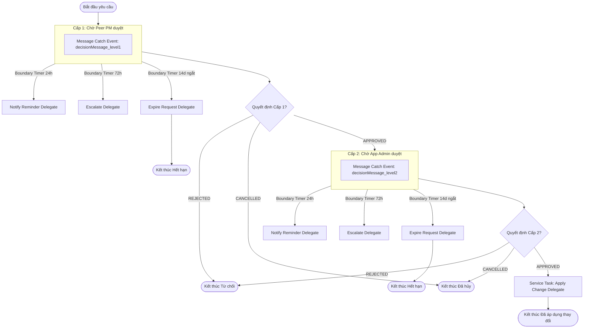

# Tài liệu Tích hợp Flowable BPMN (Camunda Integration) — EPMS

Tài liệu hướng dẫn kiến trúc, vận hành, cấu hình và quy trình tích hợp BPMN Engine vào hệ thống Quản lý Dự án Doanh nghiệp (EPMS).

---

## 1. Tổng quan Kiến trúc

- **BPMN Engine:** Flowable Core 7.1.0 nhúng (Embedded Engine), không sử dụng Spring Boot Starter tự cấu hình để tránh kết nối DB ngầm khi cờ tính năng tắt.
- **Datasource độc lập:** Flowable sử dụng DataSource và TransactionManager riêng (`epms_flowable`, port 5433 ở môi trường local), hoàn toàn tách biệt khỏi DB chính của PMS (port 5432).
- **Cơ chế An toàn:**
  - Cờ mặc định: `camunda.enabled=false`.
  - Khi cờ TẮT: Hệ thống chạy bean `NoOpProcessEngineClient`, không kết nối DB Flowable, không tạo bảng `ACT_*`, mọi API và tính năng gốc của PMS hoạt động 100% nguyên bản.
  - Khi cờ BẬT: Khởi tạo `FlowableProcessEngineClient`, tự động nạp các định nghĩa quy trình BPMN, kích hoạt `ApprovalPolicyInterceptor` và background jobs.

---

## 2. Các Biến Môi trường & Cấu hình (`application-camunda.yml`)

| Biến môi trường | Mặc định | Mô tả |
|---|---|---|
| `CAMUNDA_ENABLED` | `false` | Bật/tắt toàn bộ module tích hợp BPMN |
| `FLOWABLE_DB_URL` | `jdbc:postgresql://localhost:5433/epms_flowable` | JDBC URL kết nối cơ sở dữ liệu Flowable |
| `FLOWABLE_DB_USERNAME` | `postgres` | Tài khoản DB Flowable |
| `FLOWABLE_DB_PASSWORD` | `postgres` | Mật khẩu DB Flowable |
| `APPROVAL_PROJECT_CLOSE_ENABLED` | `false` | Bắt buộc phê duyệt 2 cấp khi đóng dự án |
| `APPROVAL_WORKFLOW_CHANGE_ENABLED` | `false` | Bắt buộc phê duyệt 2 cấp khi đổi cấu hình Workflow |
| `APPROVAL_REMINDER_AFTER_HOURS` | `24` | Số giờ chờ trước khi gửi thông báo nhắc duyệt (boundary timer không ngắt) |
| `APPROVAL_ESCALATE_AFTER_HOURS` | `72` | Số giờ chờ trước khi escalate thông báo lên cấp cao hơn |
| `APPROVAL_EXPIRE_AFTER_DAYS` | `14` | Số ngày chờ tối đa trước khi tự động hủy yêu cầu duyệt (boundary timer ngắt) |
| `APPROVAL_DUE_DATE_REMINDER_CRON` | `0 0 8 * * ?` | Biểu thức Cron chạy quy trình quét nhắc Issue đến hạn (hàng ngày lúc 08:00 AM) |
| `APPROVAL_DUE_DATE_REMINDER_HOURS_BEFORE` | `24` | Quét các Issue có hạn chót trong vòng N giờ tới |
| `APPROVAL_TIME_ZONE` | `Asia/Ho_Chi_Minh` | Múi giờ thực thi cho bộ lập lịch Timer Cron |

---

## 3. Sơ đồ Quy trình BPMN

### 3.1 Quy trình 1: Phê duyệt nhiều cấp (`approval-request.bpmn`)



### 3.2 Quy trình 2: Nhắc Issue sắp đến hạn (`due-date-reminder.bpmn`)


---

## 4. Bảng Biến Process (Process Variables)

### 4.1 Quy trình `approval-request`

| Tên biến | Kiểu dữ liệu | Phạm vi | Mô tả |
|---|---|---|---|
| `requestId` | `Long` | Toàn quy trình | ID của `ApprovalRequest` trong cơ sở dữ liệu chính của PMS (dùng làm businessKey) |
| `projectId` | `Long` | Toàn quy trình | ID dự án liên quan đến yêu cầu duyệt |
| `requestType` | `String` | Toàn quy trình | Loại yêu cầu: `PROJECT_CLOSE` hoặc `WORKFLOW_CONFIG_CHANGE` |
| `reminderDuration` | `String` | Toàn quy trình | Chu kỳ nhắc nhở ISO-8601 (mặc định `PT24H`) |
| `escalateDuration` | `String` | Toàn quy trình | Chu kỳ escalate ISO-8601 (mặc định `PT72H`) |
| `expireDuration` | `String` | Toàn quy trình | Thời hạn tự đóng yêu cầu ISO-8601 (mặc định `P14D`) |
| `decision` | `String` | Message payload | Quyết định duyệt: `APPROVED`, `REJECTED`, `CANCELLED` |
| `comment` | `String` | Message payload | Ý kiến phê duyệt hoặc lý do từ chối |

### 4.2 Quy trình `due-date-reminder`

| Tên biến | Kiểu dữ liệu | Phạm vi | Mô tả |
|---|---|---|---|
| `scanDate` | `LocalDate` | Runtime task | Ngày quét hiện tại để kiểm tra trùng lặp trong bảng `reminder_log` |
| `hoursBefore` | `Integer` | Runtime task | Số giờ giới hạn để tìm Issue sắp đến hạn (đọc từ `approvalProperties`) |

---

## 5. Hướng dẫn Khởi chạy và Kiểm thử Local

### 5.1 Khởi động DB Flowable
```bash
docker compose -f docker-compose.camunda.yml up -d
```

### 5.2 Khởi động Backend với profile Camunda
```bash
cd backend
mvn spring-boot:run -Dspring-boot.run.profiles=dev,camunda \
  -Dspring-boot.run.arguments="--approval.project-close-enabled=true --approval.workflow-change-enabled=true"
```

### 5.3 Chạy kịch bản kiểm thử tự động (Smoke Test)
```bash
bash docs/camunda/smoke-approval.sh
```
Kịch bản sẽ tự động xác minh:
1. Đăng nhập 3 vai trò (Admin, PM1, PM2).
2. Chặn thao tác đóng dự án trực tiếp qua HTTP 422 (`APPROVAL_005`).
3. Luồng 1: Duyệt thành công 2 cấp -> Dự án `CLOSED`, `applyStatus=APPLIED`.
4. Luồng 2: Từ chối ở Cấp 1 -> Trạng thái `REJECTED`, dự án giữ nguyên.
5. Luồng 3: Người tạo tự hủy -> Trạng thái `CANCELLED`, dự án giữ nguyên.
